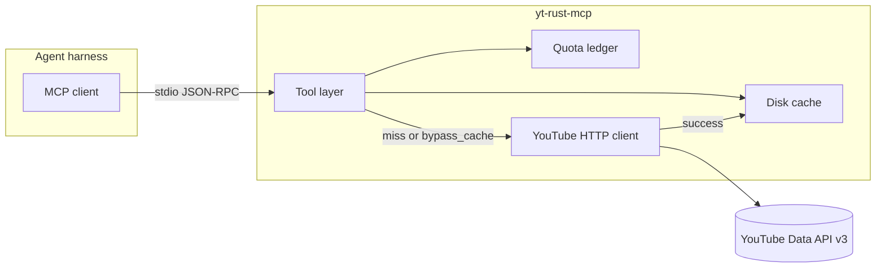
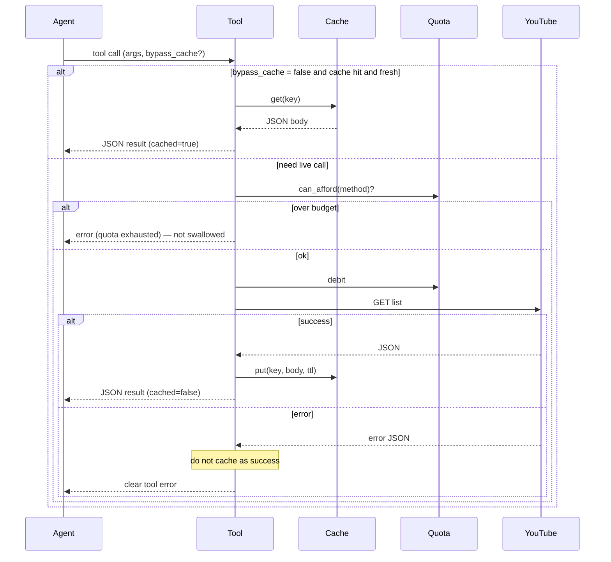

# yt-rust-mcp v1 — Design

**Date:** 2026-11-01  
**Status:** Decisions locked — pending spec review  
**Repo / Docker image:** `yt-rust-mcp`  
**Related:** [`docs/SCOPE.md`](../../SCOPE.md), [`docs/TESTING.md`](../../TESTING.md), [`docs/QUOTA.md`](../../QUOTA.md), [`docs/v1-methods.catalog.json`](../../v1-methods.catalog.json)

## 1. Goal

Ship a **lean Rust MCP server** that wraps **read-only** YouTube Data API v3 so agent harnesses can **discover and inspect** public videos, channels, and playlists — **fast**, **quota-efficient**, and **easy to understand**.

**Non-goals (v1):** OAuth, writes, captions-as-transcript, comments, live, analytics, yt-dlp, unofficial InnerTube scraping.

## 2. Product posture

- Lightweight single binary (and matching Docker image name `yt-rust-mcp`)
- Obvious tool names and copy aimed at **agent discoverability**
- Settings in **TOML**, prompts in **Markdown**, secrets in **env**
- Cache-first; never burn quota on duplicate identical reads in a day when avoidable
- Never swallow errors; quiet logs on hot paths unless debug

## 3. Architecture



### Components (one job each)

| Unit | Responsibility | Depends on |
|---|---|---|
| Config loader | Read `config/default.toml` + env overrides | filesystem, env |
| Prompt loader | Load server/tool Markdown into MCP descriptions | config paths |
| Quota ledger | O(1) debit/check for daily units + search bucket | config, clock |
| Disk cache | Keyed get/put/evict; per-method TTL; size cap | config, filesystem |
| YouTube client | Build requests, parse JSON, map errors | reqwest, API key |
| Tools | Validate args, orchestrate cache → quota → HTTP | all of the above |
| MCP runtime | `rmcp` stdio server | tools, prompts |

## 4. API surface (v1)

Implement only these Discovery methods (see catalog):

| Tool (stable name) | API | Purpose |
|---|---|---|
| `youtube_search` | `search.list` | Discover by query |
| `youtube_videos_list` | `videos.list` | Details for known video ids |
| `youtube_channels_list` | `channels.list` | Channel metadata / uploads playlist id |
| `youtube_playlists_list` | `playlists.list` | Playlist metadata |
| `youtube_playlist_items_list` | `playlistItems.list` | Videos in a playlist |

**Deferred:** `videoCategories`, `i18nLanguages`, `i18nRegions` — agents rarely need id→label tables for discoverability; add later if needed. They stay in [`docs/v1-methods.catalog.json`](../../v1-methods.catalog.json) with `"v1_status": "deferred"`. Implement only methods marked `"v1_status": "in_scope"`. Stable tool name for playlist items is `youtube_playlist_items_list` (catalog `tool_hint` matches).

**Auth:** `YOUTUBE_API_KEY` as query `key`. No OAuth in v1.

**Auth-only arguments:** If the agent passes a parameter that needs OAuth or content-owner credentials, **refuse** with a clear tool error. Do not drop the argument and call YouTube anyway. That set includes `mine`, `forMine`, `myRating`, `mySubscribers`, `managedByMe`, `forContentOwner`, `forDeveloper`, `onBehalfOfContentOwner`, and `onBehalfOfContentOwnerChannel`.

**Default `part`** when the agent omits it (explicit `part` always wins):

| Tool | Default `part` |
|---|---|
| `youtube_search` | `snippet` |
| `youtube_videos_list` | `snippet,contentDetails,statistics` |
| `youtube_channels_list` | `snippet,contentDetails,statistics` |
| `youtube_playlists_list` | `snippet,contentDetails` |
| `youtube_playlist_items_list` | `snippet,contentDetails` |

**Transport:** stdio only in v1.

## 5. Request flow



The diagram is one page. `max_pages` > 1 repeats the cache → quota → HTTP branch once per page (§6). A debit is not refunded when YouTube returns an error (failed calls can still cost quota).

## 6. Pagination

**Decision:** Agent-controlled pages — no mid-call “how many pages?” prompts (MCP tools are a poor fit for that).

| Arg | Default | Notes |
|---|---|---|
| `max_results` | 25 (cap 50) | YouTube per-page top-k |
| `max_pages` | **1** | Pages fetched in this tool call |
| `page_token` | none | Resume from prior `nextPageToken` |
| Config `max_pages_hard_cap` | **5** | Server refuses higher `max_pages` |

**Response:** JSON shaped like the API (primary payload). When more pages exist, include `nextPageToken` and a short `quota_note` that another page costs another call (use `page_token` or raise `max_pages`).

**Rationale:** Default one page keeps quota predictable; power users opt into more; hard cap prevents one runaway tool call from exhausting the day.

**Multiple pages:** Each YouTube HTTP page is its own cache entry (keyed like a one-page call that used that page’s `pageToken` and `maxResults`). The tool may concatenate `items` for the agent. It does **not** store one merged blob. Debit quota **once per live page**. A page served from cache costs 0. `cached` is `true` only when every page in that call was a cache hit. `nextPageToken` in the tool result is the token from the last page fetched (omit it when that page has none).

## 7. Caching — design and rationale

### Why cache

YouTube quota is **daily** (resets ~midnight Pacific), not monthly. Duplicate agent retries are common. **Cache-first** means identical method+params within TTL cost **0 units** — a real win for harness users.

### Store

- **On-disk** (survives process restarts)
- Default location: platform cache dir / `yt-rust-mcp` (overridable in TOML/env)
- **Max entries ≈ daily unit budget (~10,000)** — enough to remember about a full day’s distinct successful calls; eviction **LRU** (or equivalent) when over cap
- Maintenance: TTL expiry + cap eviction; interval / enablement via **env + TOML** (not hard-coded only in Rust)

### Cache key

One key per YouTube page:

- Method id (for example `youtube.videos.list`)
- Normalized query parameters that change the body YouTube would return

The key is the **effective** YouTube query after defaults are applied (`part`, `maxResults` = 25 unless the agent set it) and after auth-only arguments have been refused. Sort parameter names; split `part` and comma-separated ids, sort those tokens, and rejoin. A missing `part` and the same explicit `part` share a key. Omit parameters the agent did not set and that have no default.

**Include** `pageToken` and `maxResults` — they select a different page or page size.

**Exclude** the API `key`, `bypass_cache`, and `max_pages` (`max_pages` only controls how many page keys this call walks). The key never contains secrets.

### `bypass_cache`

Boolean tool arg, default `false`. When `true`: skip read; on success **rewrite** the record. Clearer than names like `fresh`.

### What not to cache

- Transient failures (5xx, rate limit) as if they were successful bodies
- API keys or auth material

### Per-method TTLs (rationale)

Not everything goes stale at the same rate. A **channel name** rarely changes; **search ranking** and **view counts** move faster. One global TTL either wastes quota (too short on stable data) or serves lies (too long on volatile data).

| Method / data | Default TTL | Rationale |
|---|---|---|
| `channels.list` | **7 days** | Identity/branding (title, custom URL, uploads playlist id) is stable |
| `playlists.list` | **7 days** | Playlist title/description/privacy rarely churn |
| `videos.list` | **24 hours** | Titles stable; statistics drift — daily refresh is a balance |
| `playlistItems.list` | **24 hours** | Membership/order can change when creators edit lists |
| `search.list` | **1 hour** | Ranking/recency sensitive; still worth caching identical retries; scarce search bucket |

All TTLs live in **TOML** so operators can tune without recompiling.

**Entry cap vs TTL:** Long-lived channel rows stay until TTL **or** LRU eviction under the ~10k cap — whichever comes first. Cap tracks “about a day of distinct calls,” not Google’s nonexistent monthly quota.

## 8. Quota

- YouTube has **no** “remaining quota” endpoint on Data API v3
- v1 tracks usage **locally** (units + separate search call count)
- Persist those counters in `quota-ledger.json` inside the cache directory so a process restart does not zero the day’s spend
- Reset both counters when the calendar day changes in `America/Los_Angeles` (YouTube’s quota day, ~midnight Pacific)
- Prefer ID-based tools over `youtube_search` when an id is known
- Soft-fail with a clear error before predicted exhaustion
- Optional later: Cloud Monitoring (out of v1 scope)

Defaults (overridable): `YOUTUBE_QUOTA_BUDGET=10000`, `YOUTUBE_SEARCH_BUDGET=100` (see `.env.example`).

## 9. Responses and errors

- **JSON** primary result — closest to the API, easiest for agents to parse
- Thin envelope allowed: `cached`, `quota_note`, `nextPageToken` when useful — without inventing a parallel schema for the YouTube payload
- **Never swallow errors**; map Google `error` objects to readable tool errors (status + reason); no API key in messages or logs

## 10. Config and prompts layout

```
config/default.toml          # TTLs, caps, budgets, paths, log defaults
prompts/server.md            # MCP server instructions (read-only, tools list)
prompts/tools/*.md           # when to use / when not / quota hint
.env                         # secrets (gitignored)
.env.example                 # template (tracked)
AGENTS.md                    # local only (gitignored)
```

## 11. Logging

- `tracing` → **stderr** only
- Default: lean (errors/warns; no per-hit spam)
- Debug: cache hit/miss, debit, request shape — never the API key

## 12. Testing

See [`docs/TESTING.md`](../../TESTING.md).

- Unit tests for parsers, tools, quota, cache keying, pagination caps, error mapping
- **Fixtures only** under `fixtures/youtube/` — **never** live Google in `cargo test`
- Manual human smoke with a real key is outside the suite

## 13. Packaging

- Binary / crate name aligned with repo: **`yt-rust-mcp`**
- Docker image name: **`yt-rust-mcp`**
- License: **MIT** (default unless changed at publish time)

## 14. Complexity budget

- Dispatch, cache lookup, quota check: **O(1)** intended
- Fetching N pages: **O(N)** network (unavoidable); no quadratic page merging

## 15. Implementation order (preview)

1. Cargo project + config/prompt loading  
2. Fixture-backed YouTube client + error mapping  
3. Disk cache + quota ledger  
4. MCP tools + server instructions  
5. Docker image `yt-rust-mcp`  
6. Docs polish / README for harness wiring  

Detailed plan comes after this spec is approved.
